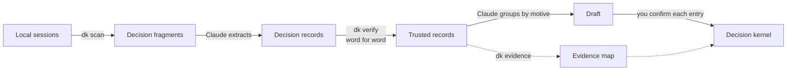

<div align="center">

# decision-kernel

**Teach Claude Code how *you* make decisions, learned from your own conversation history.**

No rules to write, no questionnaire to fill in. It reads your past sessions with the AI, finds every trade-off you made and every "because" you said, <br>
and distils them into an always-loaded **decision kernel**. The next time a similar question comes up, the AI decides your way instead of asking you again.

[](https://www.python.org/)
[](pyproject.toml)
[](https://claude.com/claude-code)
[](LICENSE)

[简体中文](README.md) | **English**

</div>

---

## Sound familiar?

> **Claude:** Should I delete this old endpoint, or keep it for now?<br>
> **You:** Keep it. Just disable it.<br>
> *(three days later, different project)*<br>
> **Claude:** Should I just drop this old table?<br>
> **You:** …didn't I already tell you?

The AI is conscientiously asking for your input, but you've answered this kind of question dozens of times.
Writing it into `CLAUDE.md` doesn't help either. You wrote "disable old endpoints"; next it meets an old table, an old config, an old branch. **Rules only cover the cases you wrote down.**

What the AI is missing isn't a rule. It's **why** you chose what you chose. Both answers above come from the same judgement:

> **Match caution to reversibility, not to how big the change looks.**
> Disable instead of delete, run side by side instead of overwriting, copy instead of modifying in place. Not sure it's still needed → keep it. Deleting is an asymmetric bet: win and you save a little effort, lose and it can't be undone.
>
> <sub>Translated from the author's own distilled kernel. [See all 11 entries](examples/decision-kernel.md) (in Chinese).</sub>

With that one entry, the AI can work out what you'd do with an old table or an old branch, even though you never mentioned either.

## What you get

A few hundred lines of Markdown, loaded into every Claude Code session. Each entry has three parts:

| | Contains | Purpose |
|---|---|---|
| **Why** | What you care about and what you're protecting | The AI understands the motive instead of memorising behaviour |
| **Questions to ask at a trade-off** | A handful of questions | The AI can reason about **situations you never wrote down** |
| **Boundaries** | When it doesn't apply | Stops a principle from being over-applied |

A final conflict-resolution section says which entry wins when several apply at once.

## Real numbers

The author distilled about 10 months of their own Claude Code history:

```
3.4M characters of conversation → 1,377 decision fragments → 784 decision records → 125 motives → 11 kernel entries
```

- In the first incremental review, **all 152 new decisions could be derived from the existing kernel**. No uncovered pattern appeared.
- The quote verifier once caught a subagent **extending the user's quote with a sentence of its own**. This kind of error, where the AI invents a principle in your name, is kept out of the kernel.

## Why you can trust it

- **Your data stays on your machine.** Local scripts only, zero dependencies, no external services.
- **Every "you said" is checkable.** Each piece of evidence behind the kernel is a verbatim quote, and the script checks it word for word against your original sessions. Quotes that don't match get sent back.
- **You approve every entry.** The AI only drafts. Nothing goes into the kernel until you've reviewed it entry by entry.
- **It evolves with you.** Run `/decisions` every few weeks to test the kernel against new sessions: what still holds, what's missing, and where you've changed your mind.

## Get started in three steps

```bash
# 1. Install (Python 3.13+, zero dependencies)
uv tool install git+https://github.com/Tespera/decision-kernel

# 2. Add the two Claude Code commands
git clone https://github.com/Tespera/decision-kernel /tmp/dk
cp /tmp/dk/claude/commands/*.md ~/.claude/commands/

# 3. In Claude Code, run
/distill
```

`/distill` walks you through the whole process: filter sessions → extract decisions → verify quotes → group by motive → draft → you confirm each entry → written to `~/.claude/rules/decision-kernel.md`.
After that, run `/decisions` every few weeks for an incremental review.

## How it compares

| | Hand-written CLAUDE.md rules | AI auto-memory | **decision-kernel** |
|---|---|---|---|
| Source | Your recollection | Notes the AI takes as you chat | **Your entire session history** |
| Content | "When X, do Y" | Scattered facts and preferences | **Motive + questions + boundaries** |
| Unwritten situations | Not covered | Not covered | Can be reasoned out |
| Can it misremember? | Depends on your memory | May record the AI's guess as your words | Every quote is verified word for word |
| Who decides | You | The AI | You, entry by entry |

It complements auto-memory: memory records *what happened*; the kernel records *how you judge*.

## FAQ

<details>
<summary><b>How much history do I need?</b></summary>

More is better. With fewer than 30 fragments, the tool tells you a distillation isn't worth it yet. The author's first run used about 10 months of history, which gave 1,377 fragments. Smaller histories work too: a candidate with fewer than 3 pieces of evidence doesn't enter the kernel. It waits in a watchlist until later reviews collect enough evidence.
</details>

<details>
<summary><b>Does it work with English conversations?</b></summary>

It runs, but matches less: the filtering patterns are currently tuned for Chinese. PRs adding patterns for your language in `src/decision_kernel/filters.py` are very welcome.
</details>

<details>
<summary><b>Is my conversation data uploaded anywhere?</b></summary>

No. The scripts only read your local `~/.claude/` and write to a local workbench (default `~/.decision-kernel`). Extraction and synthesis happen in your own Claude Code session, the same way you normally use it for coding. The workbench contains your verbatim words, so **don't commit it to a public repository.**
</details>

<details>
<summary><b>Claude Code deletes old sessions. Does that matter?</b></summary>

Yes. Claude Code periodically deletes old session logs, so the sooner you run it for the first time, the better. After that, the extracted fragments stay in your workbench and no longer depend on the original logs.
</details>

<details>
<summary><b>Why not just ask the AI to summarise a list of rules?</b></summary>

That's exactly what the author tried first. It produced 37 rules, and every one was rejected: rules were too rigid to handle cases they didn't cover. Grouping decisions by scenario also split the single most important motive across several rules, so it was no longer visible in any of them. The full story is in [docs/METHOD.md](docs/METHOD.md) (in Chinese).
</details>

## How it works



<details>
<summary><b>What each step does</b></summary>

| Step | Who | What |
|---|---|---|
| `dk scan` | script | Reads `~/.claude/projects/**/*.jsonl` (full conversations) and `~/.claude/history.jsonl` (your inputs, kept much longer). Picks out fragments where a decision happened: answers to the AI's questions, approval or rejection of what the AI just did, and instructions about how the AI should work. Removes system text that was injected in the user's name. Calls no model. |
| extract | Claude / subagents | Turns each fragment into a structured record whose core is the verbatim quote and the trade-off axis ("A > B"). Transcribes; does not interpret. |
| `dk verify` | script | The anti-hallucination gate: every quote must appear word for word in the original session. It catches paraphrases, the AI's words attributed to you, and quotes taken from the wrong turn. |
| synthesise | Claude, with you | Groups by **motive**, not scenario. Opposite choices on the same axis aren't settled by vote; they're explained by a hidden condition, which usually becomes a boundary. |
| confirm | you | Review each entry: keep, rewrite, delete or merge. |
| `dk evidence` | script | Builds an evidence map: for each entry, how many decisions back it, how many projects they come from, the date range, and the motives behind it. |

</details>

<details>
<summary><b>CLI reference</b></summary>

| Command | Does |
|---|---|
| `dk init [DIR]` | Create the workbench (default `~/.decision-kernel`, or `$DK_WORKBENCH`) with the extraction guides |
| `dk scan [--all \| --since DATE]` | Filter fragments; by default it continues from where the last review ended |
| `dk batch [--size 150]` | Split fragments into batches for parallel subagents; IDs automatically avoid earlier ones |
| `dk verify` | Check every quote word for word; exits 1 if anything needs fixing |
| `dk axes` | Write the list of trade-off axes for review |
| `dk merge` | Append this round's records, motives and kernel mappings to the cumulative files |
| `dk evidence --kernel PATH` | Build the evidence map |
| `dk finish` | Record the completion date as the starting point for the next scan |
| `dk status` | Show the workbench state |

Each round works in `incr/` and is archived automatically once finished. An unfinished round is never overwritten: `--redo` moves it aside instead of deleting it.

</details>

## Contributing

Issues and PRs are welcome, especially:

- Filtering patterns for other languages.
- Adapters for other AI coding tools' log formats.
- Kernel entries from your own distillation that could help others (strip quotes and project names first).

If it saved you from answering the same question one more time, a ⭐ helps others find it.

## License

[MIT](LICENSE)
