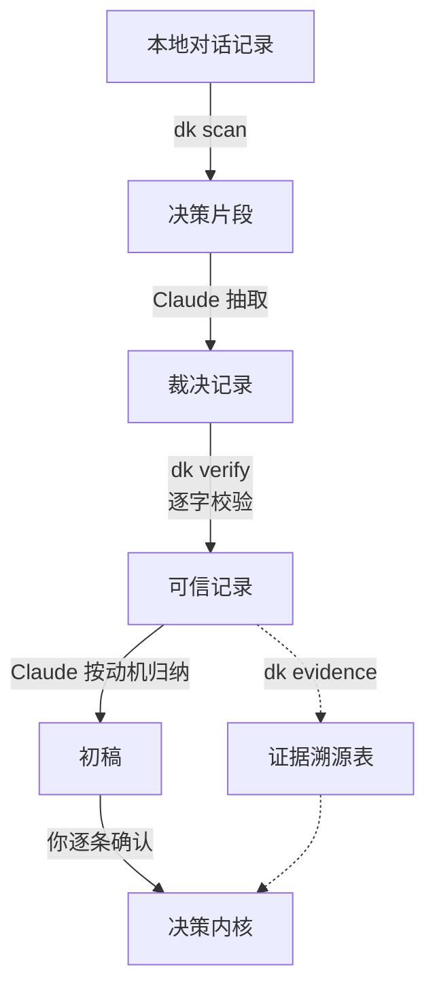

<div align="center">

# decision-kernel

**让 Claude Code 学会你的判断方式——从你自己的对话记录里。**

不用写规则，不用填问卷。它读你和 AI 的历史对话，找出你做过的每一次取舍、说过的每一句「因为」，<br>
提炼成一份常驻的**决策内核**：下次遇到同类问题，AI 按你的思路自己拿主意，不再一遍遍来问你。

[](https://www.python.org/)
[](pyproject.toml)
[](https://claude.com/claude-code)
[](LICENSE)

**简体中文** | [English](README.en.md)

</div>

---

## 你是不是也这样？

> **Claude：** 这个旧接口要删掉，还是先保留？<br>
> **你：** 保留，先停用。<br>
> *（三天后，另一个项目）*<br>
> **Claude：** 这张旧表要不要直接删？<br>
> **你：** ……我上次不是说过了吗。

AI 每次都在认真征求你的意见，可同一类问题你已经回答过几十遍了。
写进 `CLAUDE.md` 也不管用：你写的是「旧接口先停用」，它遇到的是「旧表」「旧配置」「旧分支」——**规则只覆盖你写过的场景。**

AI 缺的不是规则，是你**为什么**这么选。上面两次回答背后其实是同一个判断：

> **按可逆性分配谨慎，不按事情大小。**
> 停用代替删除、并存代替覆盖、副本代替原地改造。不确定还有没有用 → 保留。删除是不对称的赌注：赌赢省一点事，赌输不可挽回。
>
> <sub>—— 摘自作者本人蒸馏出的内核，[完整 11 条看这里](examples/decision-kernel.md)</sub>

有了这一条，AI 遇到你没写过的「旧表」「旧分支」，也能推出你会怎么选。

## 它产出什么

一份几百行的 Markdown，常驻在每个 Claude Code 会话里。每条内核三段：

| | 写的是 | 作用 |
|---|---|---|
| **为什么** | 你在乎什么、在保护什么 | 让 AI 理解动机，而不是死记行为 |
| **遇到取舍时问自己** | 几个提问 | 让 AI 推出**没写过的场景**该怎么做 |
| **边界** | 什么时候不适用 | 防止一条原则被用过头 |

最后还有一段「冲突裁决」：几条同时命中时，听哪一条的。

## 真实跑出来的数字

作者用它蒸馏了自己约 10 个月的 Claude Code 记录：

```
340 万字符的对话  →  1377 个决策片段  →  784 条裁决记录  →  125 条动机  →  11 条内核
```

- **内核会被新对话检验，也会被修正。** 第一轮增量复盘（2026-09）的 152 条裁决里，**150 条能由已有内核推出**，另外 2 条是“内核推得出、AI 却还在问”的提问信号，没有新模式，也没有相悖。不过这批裁决有一部分早于内核定稿，不算严格的样本外检验。第二轮（2026-10）的 330 条里冒出了 2 个新模式和 1 处相悖，作者据此修订了两条内核，其余候选进了观察清单。逐条判定由 Claude 按“内核里的提问能否直接推出这条裁决”完成，作者看报告拍板。
- 原话校验抓到过一个 subagent **替用户续写了一句原话**。这种「AI 替你发明原则」的错误，会被挡在内核之外。

<details>
<summary><b>每条内核背后有多少证据</b>（作者本人 <code>dk evidence</code> 的统计，截至 2026-10，含两轮增量复盘）</summary>

| 内核 | 裁决记录 | 来自项目 | 时间跨度 |
|---|--:|--:|---|
| K1 · 要最佳解，不是能用的解 | 64 | 11 | 2026-04 ~ 2026-10 |
| K2 · 前提要硬、判断要靠可见实物 | 56 | 13 | 2026-03 ~ 2026-09 |
| K3 · 只在只有我能回答时打断我 | 40 | 11 | 2026-03 ~ 2026-09 |
| K4 · 按可逆性分配谨慎 | 51 | 10 | 2026-03 ~ 2026-09 |
| K5 · 在根因层解决 | 42 | 6 | 2026-04 ~ 2026-09 |
| K6 · 产出物的标准由读者定义 | 103 | 15 | 2026-03 ~ 2026-10 |
| K7 · 不依赖人的记忆和自觉 | 35 | 8 | 2026-03 ~ 2026-09 |
| K8 · 同一个决策不做第二次 | 23 | 8 | 2026-04 ~ 2026-09 |
| K9 · 先回到目的，再选手段 | 26 | 8 | 2026-03 ~ 2026-09 |
| K10 · 保留真实信息与判断 | 7 | 4 | 2026-06 ~ 2026-08 |
| K11 · 把要的做完整，不做没要的 | 28 | 8 | 2026-04 ~ 2026-09 |

只公开统计。每条裁决背后的逐字原话、项目名都留在作者本地。
</details>

## 为什么值得信任

- **数据只走你自己的 Claude Code**。`dk` 是纯本地脚本，零依赖，不联网。需要理解语义的抽取和归纳在你自己的 Claude Code 会话里完成，和你平时写代码时发给 Claude 的内容走同一条通道，不经过任何第三方服务。
- **每句「你说过」都能查**。内核背后的每条证据都是逐字原话，脚本会和原始记录逐字比对，对不上的直接打回。
- **每一条都由你拍板**。AI 只出初稿，内核里的每一条都要你逐条确认才会写入。
- **随你一起进化**。每隔几周跑一次 `/decisions`，用新对话检验内核：哪条还对、缺了什么、哪里被你推翻了。

## 三步上手

```bash
# 1. 安装（Python 3.10+，零依赖）
uv tool install git+https://github.com/Tespera/decision-kernel

# 2. 把 /distill 和 /decisions 两个命令装进 Claude Code
dk install-commands

# 3. 在 Claude Code 里输入
/distill
```


`/distill` 会带你走完全程：筛选对话 → 抽取裁决 → 校验原话 → 归纳动机 → 出初稿 → 你逐条确认 → 写入 `~/.claude/rules/decision-kernel.md`。
之后每隔几周跑一次 `/decisions` 做增量复盘。

> [!TIP]
> Claude Code 默认只保留 **30 天**会话日志，到期静默删除。还没改过的话，先在 `~/.claude/settings.json` 里加一行 `"cleanupPeriodDays": 3650`，别让以后的对话记录再丢。

## 和其他做法有什么不同

| | 手写 CLAUDE.md 规则 | AI 自动记忆 | **decision-kernel** |
|---|---|---|---|
| 来源 | 你凭印象写 | AI 边聊边记 | 你的**全部历史对话** |
| 内容 | 「遇到 X 做 Y」 | 零散的事实和偏好 | **动机 + 判据 + 边界** |
| 没写过的场景 | 管不到 | 管不到 | 能推出来 |
| 会不会记错 | 取决于你的记性 | 可能把 AI 的猜测当成你说的 | 每句原话都经过逐字校验 |
| 谁拍板 | 你 | AI | 你逐条确认 |

它和自动记忆不冲突：记忆记「发生过什么」，内核记「你怎么判断」。

## 常见问题

<details>
<summary><b>需要多少对话记录才够？</b></summary>

越多越稳。片段少于 30 条时，工具会提示「不值得蒸馏」。作者第一次用了约 10 个月的记录，得到 1377 个片段。记录少一些也能跑：证据不足 3 条的候选不会进内核，会先放进观察清单，等后续复盘攒够证据再说。
</details>

<details>
<summary><b>跑一次要多久、耗多少额度？</b></summary>

作者的实测：

| | 首次蒸馏 | 增量复盘（每次） |
|---|---|---|
| 规模 | 1377 片段 → 784 条裁决 | 288～541 片段 → 152～330 条裁决 |
| 机器实际在跑 | 约 2 小时 | 13～29 分钟 |
| 其中抽取 | 8 个 subagent 并行，约 19 分钟 | 4 个 subagent 并行，6～8 分钟 |
| token | 约 3300 万，其中输出约 76 万，绝大部分是缓存读取 | 约 900 万，其中输出约 16 万 |

首次蒸馏在日历上跨了 3 天：机器只跑了约 2 小时，其余是会话空闲，等作者看稿、拍板。抽取只是转录，交给 Sonnet 级别的 subagent 就够用（作者首次的 8 个批次里有 5 个用的是 Sonnet），能省不少额度。
</details>

<details>
<summary><b>英文对话能用吗？</b></summary>

能跑，但命中率会低：筛选规则目前是针对中文对话调的。欢迎在 `src/decision_kernel/filters.py` 里补充你所用语言的规则，并提交 PR。
</details>

<details>
<summary><b>我的对话内容会上传到哪里吗？</b></summary>

除了你自己的 Claude Code 会话，哪里都不去。`dk` 脚本不联网，只读本机的 `~/.claude/`、写本机的工作目录（默认 `~/.decision-kernel`）。抽取和归纳由你自己的 Claude Code 会话完成，片段作为对话内容发给 Claude，和你平时用它写代码一样，不经过任何第三方服务。工作目录里有你的原话，**请不要提交到公开仓库**。
</details>

<details>
<summary><b>Claude Code 的旧对话会被清理，会影响吗？</b></summary>

会。Claude Code 默认只保留 30 天会话日志（`~/.claude/projects/` 下的完整对话），到期在后台静默删除；你的输入历史 `history.jsonl` 不受这个设置影响，保留得更久。

所以有两件事要尽早做：

1. 在 `~/.claude/settings.json` 里把保留期调长，比如 `"cleanupPeriodDays": 3650`（单位是天，最小 1），从今天起不再丢记录。已经删掉的找不回来。
2. 尽早跑第一次。跑过之后，抽出来的片段会留在工作目录里，不再依赖原始日志。
</details>

<details>
<summary><b>为什么不直接让 AI 总结出一份规则？</b></summary>

作者第一次就是这么做的，得到 37 条规则，最后全部推翻：规则太死，遇到没覆盖的场景就没法用。而且按场景归类，会把最重要的那条动机拆散进好几条规则里，哪条都看不出它。完整经过见 [docs/METHOD.md](docs/METHOD.md)。
</details>

## 工作原理



<details>
<summary><b>每一步具体做什么</b></summary>

| 步骤 | 谁做 | 做什么 |
|---|---|---|
| `dk scan` | 脚本 | 读 `~/.claude/projects/**/*.jsonl`（完整对话）和 `~/.claude/history.jsonl`（你的输入，保留得更久），挑出发生了决策的片段：回答 AI 的提问、对 AI 刚做的事表示认可或否决、规定 AI 该怎么工作。剔除以用户身份注入的系统文本。不调用任何模型。 |
| 抽取 | Claude / subagent | 把每个片段转成结构化记录，核心是逐字原话和权衡轴（「A > B」）。只转录、不解读。 |
| `dk verify` | 脚本 | 反幻觉闸门：每条原话都必须能在原始记录里逐字找到，能抓出改写、把 AI 的话安到你头上、张冠李戴到上一轮的情况。 |
| 归纳 | Claude，和你一起 | 按**动机**而不是按场景归纳。同一条轴上的相反选择不投票，而是找出隐藏条件，那通常就是边界。 |
| 确认 | 你 | 逐条审，保留、改写、删除或合并。 |
| `dk evidence` | 脚本 | 生成溯源表：每条内核由多少条裁决支撑、来自几个项目、时间跨度、背后的动机。 |

</details>

<details>
<summary><b>命令行参考</b></summary>

| 命令 | 作用 |
|---|---|
| `dk install-commands [--force]` | 把 `/distill`、`/decisions` 装进 `~/.claude/commands/`；已有同名且内容不同的文件默认跳过，`--force` 先备份为 `.bak` 再覆盖 |
| `dk init [目录]` | 建工作目录（默认 `~/.decision-kernel`，或 `$DK_WORKBENCH`），放入抽取规范、方法说明和示例内核 |
| `dk scan [--all \| --since 日期]` | 筛选片段；默认从上次复盘结束处接着扫 |
| `dk batch [--size 150]` | 切批，交给多个 subagent 并行抽取；编号自动避开历史 |
| `dk verify` | 逐字校验原话；有问题时退出码为 1 |
| `dk axes` | 生成权衡轴清单，供归纳时通览 |
| `dk merge` | 把本轮记录、动机、内核映射并入累积文件 |
| `dk evidence --kernel 路径` | 生成证据溯源表 |
| `dk finish` | 记下本轮完成日期，作为下次扫描的起点 |
| `dk status` | 查看工作目录状态 |

每一轮都在 `incr/` 里进行，完成后自动归档。没完成的那一轮不会被覆盖，`--redo` 只会把它挪走，不会删除。

</details>

## 贡献

欢迎提 Issue 和 PR，尤其是这几类：

- 其他语言的筛选规则；
- 适配其他 AI 编程工具的日志格式；
- 你用它蒸馏出的内核里，有哪些条目对别人也有启发（去掉原话和项目名后再分享）。

如果它帮你少回答了几次同样的问题，欢迎点个 ⭐，让更多人看到它。

## 许可证

[MIT](LICENSE)
